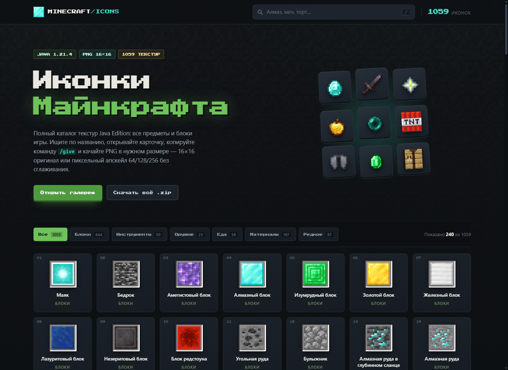

# Иконки Майнкрафта

Статический сайт-галерея оригинальных текстур Minecraft 1.21.4 (Java Edition):
все предметы и блоки игры — 1 059 иконок.

**Живая версия:** <https://mambetovdamir7-cyber.github.io/minecraft-icons/>

**Автор: smuzzy milovski** — Telegram [@smuzzych](https://t.me/smuzzych).



## Что умеет

- **1 059 текстур**: все предметы игры + все блоки, у которых нет предметной иконки.
- **Поиск** по русскому и английскому названию и по ID (клавиша `/`).
- **Фильтр по 6 категориям** с живым счётчиком.
- **Карточка предмета**: увеличенная иконка 256 px, описание, ID, размер, путь к текстуре.
- **Скачивание PNG в нужном размере**: 16×16 — оригинал, 64/128/256 — пиксельный апскейл
  через `canvas` с `imageSmoothingEnabled = false` (целые пиксели, без мыла).
- **Архив** `icons.zip` со всеми текстурами.
- **Копирование команды** `/give @p minecraft:<id> 1` в один клик.
- Навигация стрелками ← → между предметами, закрытие по `Esc`.
- Полная адаптивность и поддержка `prefers-reduced-motion`.

## Как открыть

Самый простой способ — двойной клик по `index.html` (всё работает и по `file://`,
скрипты подключены обычными тегами, без модулей).

Если нужен локальный сервер:

```powershell
cd minecraft-icons
python -m http.server 8080
# затем открыть http://127.0.0.1:8080
```

## Структура

```
minecraft-icons/
├── index.html            разметка страницы
├── styles.css            оформление (тёмный инвентарный UI)
├── app.js                поиск, фильтры, карточка, копирование
├── data.js               автогенерация: метаданные всех иконок
├── build_full.py         сборщик полного каталога (все item/ и block/)
├── data.json             те же данные в JSON (для других проектов)
├── icons.zip             все PNG одним архивом
├── build_assets.py       сборщик: качает текстуры и генерирует ассеты
└── assets/
    ├── icons/*.png       оригинальные текстуры 16×16
    ├── fonts/            Press Start 2P (пиксельный шрифт, OFL)
    ├── bg-stone.png      тайловый фон
    └── favicon.png       лицо крипера 8×8
```

## Как добавить свою иконку

1. Откройте `build_assets.py`, найдите список `ITEMS`.
2. Добавьте строку в том же формате:

   ```python
   ("redstone_lamp", "Редстоун-лампа", "Redstone Lamp", "block",
    "Светится при сигнале редстоуна.", None),
   ```

   Поле `None` — авто-поиск в `item/` и `block/`. Если текстура лежит по особому пути,
   укажите его явно: `"block/tnt_side.png"`.
3. Запустите сборщик:

   ```powershell
   python build_assets.py
   ```

   Скрипт скачает текстуру, обрежет анимационные кадры, перепишет `data.js`,
   `data.json` и `icons.zip`. Страницу перезагрузите — карточка появится сама.

Свою картинку можно просто положить в `assets/icons/` и добавить запись
в `data.js` вручную (поля: `id`, `ru`, `en`, `cat`, `note`, `file`, `w`, `h`).

Категории: `block`, `tool`, `weapon`, `food`, `material`, `rare`.

## Автор

Сайт собрал **smuzzy milovski**.
Telegram: [@smuzzych](https://t.me/smuzzych)

## Правовая заметка

Текстуры Minecraft принадлежат Mojang AB / Microsoft. Проект фанатский и не
связан с Mojang. Шрифт Press Start 2P распространяется по лицензии SIL OFL 1.1.
